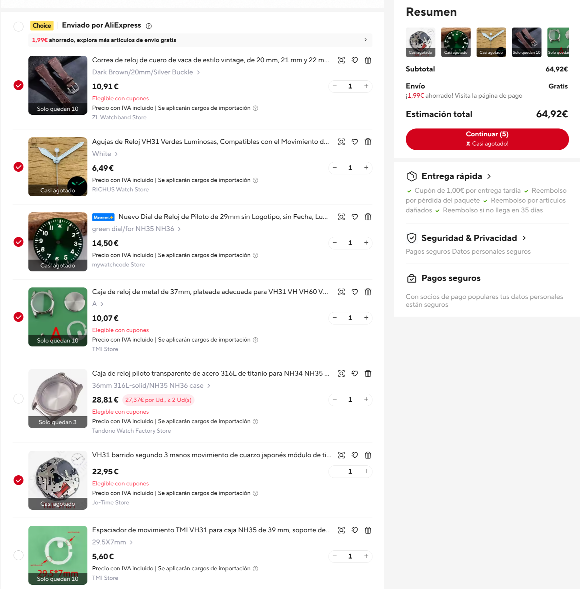
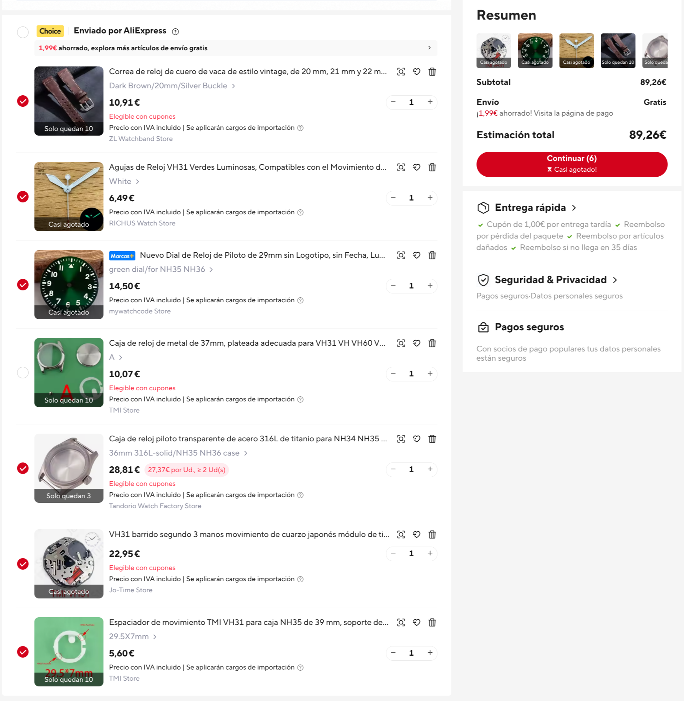
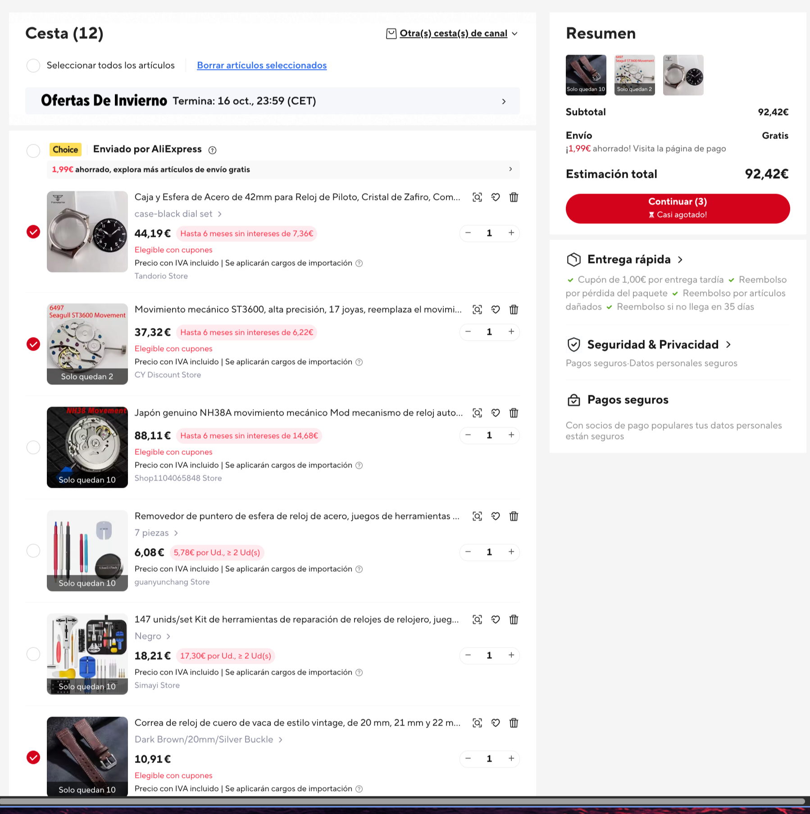

# Custom AliExpress Watch Build Workshop

The workshop is done in two sessions: 

- 00 - Shopping cart + order
- 01 - Watch building!

## Sample builds

### 36 mm pilot watch

- 65 € - Brass case with TMI sweep seconds quartz movement (VH31) 
- 90 € - Steel case with TMI sweep seconds quartz movement (VH31)
- 150 € -Steel case with automatic mechanical TMI movement (NH38) 

### 42 mm pilot watch

- 93 € - Steel case with manual winding mechanical movement (ST3600)

## BOM

### Watch

- Movement (incl. stem )
- Dial 
- Watch hands 
- Case (incl. o-ring, movement spacer and crown)
- Strap or bracelet (incl. spring bars)

### Tools and Supplies

#### Shared

- Caliper
- Pliers
- Precision screwdriver kit
- Watch dust air blower
- Watch hands remover
- Watch hands presser
- Metal files (for sanding)
- Threadlocker
- Rubber squash ball (for the back cover of the case)
- Waterproof grease kit for o-rings
- Synthetic watch lubrication oil

#### Personal

- Gloves or rubber finger cots 
- Casing cushion
- Tweezers 
- Movement holder
- Rodico putty
- Watch Tools mat
- Watchmaker magnifier(s)

## References

- [Youtube video](https://youtu.be/Z5IPY69v_p4?si=WOzpNyMtBu1kA7Oz)
- 
- 
- 
